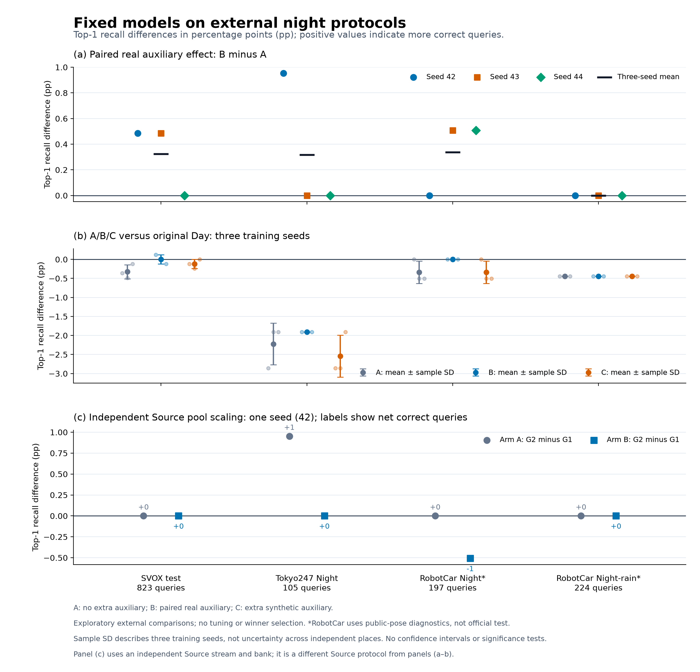

# 既定模型的外部夜间检索评测

**52/52 次新评测已完成：13 个固定模型 × 4 个夜间协议。** 本轮只执行推理，训练权重没有更新；所有模型均使用 FP32、原生 224 输入、原始 Day checkpoint 的固定图库，未使用 TTA 或 Teacher/Student 融合。

A 为无额外辅助，B 增加真实配对辅助，C 增加合成配对辅助。P0 使用 seed 42/43/44；G1/G2 使用 seed 42 的独立 Source 流和独立 Source bank，保持训练步数及 Source 曝光数一致。13 个 checkpoint 均完成 1 个 epoch、908 次更新，主分支 7263 个视图、Source 1816 个视图；B/C 各自另有 1816 个真实/合成辅助视图。P0 与 G1/G2 的 Source 采样及候选 bank 不同，跨轴比较不能单独归因于池规模。

## 结果判断

- **SVOX test**：B 的平均 Top-1 为 92.71% ± 0.12 pp，较原始 Day +0.00 pp，较 A +0.32 pp；三个 seed 的 B−A 命中变化为 +4/+4/+0，B−C 平均 +0.12 pp。
- **Tokyo247 Night**：B 的平均 Top-1 为 84.76% ± 0.00 pp，较原始 Day -1.90 pp，较 A +0.32 pp；三个 seed 的 B−A 命中变化为 +1/+0/+0，B−C 平均 +0.63 pp。
- **RobotCar Night***：B 的平均 Top-1 为 90.86% ± 0.00 pp，较原始 Day +0.00 pp，较 A +0.34 pp；三个 seed 的 B−A 命中变化为 +0/+1/+1，B−C 平均 +0.34 pp。
- **RobotCar Night-rain***：B 的平均 Top-1 为 95.09% ± 0.00 pp，较原始 Day -0.45 pp，较 A +0.00 pp；三个 seed 的 B−A 命中变化为 +0/+0/+0，B−C 平均 +0.00 pp。

B 相对原始 Day 的平均 Top-1 在 0/4 个协议提高、2/4 持平、2/4 降低。B−A 用于衡量加真实辅助后的整体变化；B−C 还涉及真实/合成数据源差异，不能证明“真实配对关系”本身的因果贡献。每个 seed 只有一次训练；均值和样本标准差描述这三个 checkpoint 的离散程度，没有显著性结论。

扩大 Source 池的 Top-1 命中变化（G2−G1）为：SVOX test：A +0、B +0；Tokyo247 Night：A +1、B +0；RobotCar Night*：A +0、B -1；RobotCar Night-rain*：A +0、B +0。这些是同一 seed 的固定预算比较，尚不足以给出多 seed 的规模规律。

这轮外部结果用于检验预先固定的方案。默认模型保持由开发集流程决定；后续权重、供体或超参数改动应在开发集完成，再使用另设的未使用验证集检查，避免把本轮外部分数用于反复选择。

图中依次展示 B−A 的逐 seed 变化、A/B/C 相对原始 Day 的变化，以及 G2−G1 的变化。纵轴为 Top-1 百分点，误差线仅表示三个 seed 的样本标准差；图用于区分辅助收益、原始模型退化和 Source 规模变化。

## 全部模型结果

下表每格为 **R@1 / R@5 / R@10 的命中查询数**，各列使用固定查询总数。

| 模型 | SVOX test（823） | Tokyo247 Night（105） | RobotCar Night*（197） | RobotCar Night-rain*（224） |
|---|---:|---:|---:|---:|
| Original Day | 763 / 810 / 816 | 91 / 95 / 98 | 179 / 187 / 190 | 214 / 216 / 218 |
| seed42_A | 760 / 813 / 816 | 88 / 96 / 100 | 179 / 188 / 190 | 213 / 216 / 217 |
| seed42_B | 764 / 813 / 816 | 89 / 96 / 98 | 179 / 187 / 190 | 213 / 215 / 218 |
| seed42_C | 762 / 812 / 816 | 88 / 96 / 98 | 179 / 188 / 191 | 213 / 215 / 217 |
| seed43_A | 759 / 812 / 816 | 89 / 96 / 99 | 178 / 188 / 191 | 213 / 216 / 218 |
| seed43_B | 763 / 813 / 816 | 89 / 96 / 99 | 179 / 187 / 190 | 213 / 214 / 217 |
| seed43_C | 761 / 812 / 816 | 88 / 96 / 98 | 178 / 187 / 192 | 213 / 216 / 218 |
| seed44_A | 762 / 811 / 816 | 89 / 96 / 100 | 178 / 188 / 192 | 213 / 216 / 219 |
| seed44_B | 762 / 813 / 816 | 89 / 96 / 98 | 179 / 187 / 190 | 213 / 216 / 218 |
| seed44_C | 763 / 812 / 816 | 89 / 96 / 98 | 178 / 188 / 192 | 213 / 216 / 219 |
| G1_A | 761 / 810 / 816 | 89 / 96 / 100 | 178 / 188 / 190 | 213 / 216 / 217 |
| G1_B | 763 / 812 / 816 | 89 / 96 / 98 | 180 / 187 / 190 | 213 / 215 / 218 |
| G2_A | 761 / 812 / 816 | 90 / 96 / 100 | 178 / 188 / 190 | 213 / 216 / 218 |
| G2_B | 763 / 812 / 816 | 89 / 96 / 98 | 179 / 187 / 190 | 213 / 215 / 218 |

## P0 三 seed 均值与波动

均值为百分比；± 后为样本标准差，单位为百分点（pp），n=3。

| 协议 | 组别 | R@1 | R@5 | R@10 |
|---|---|---:|---:|---:|
| SVOX test | A | 92.39 ± 0.19 | 98.66 ± 0.12 | 99.15 ± 0.00 |
| SVOX test | B | 92.71 ± 0.12 | 98.78 ± 0.00 | 99.15 ± 0.00 |
| SVOX test | C | 92.59 ± 0.12 | 98.66 ± 0.00 | 99.15 ± 0.00 |
| Tokyo247 Night | A | 84.44 ± 0.55 | 91.43 ± 0.00 | 94.92 ± 0.55 |
| Tokyo247 Night | B | 84.76 ± 0.00 | 91.43 ± 0.00 | 93.65 ± 0.55 |
| Tokyo247 Night | C | 84.13 ± 0.55 | 91.43 ± 0.00 | 93.33 ± 0.00 |
| RobotCar Night* | A | 90.52 ± 0.29 | 95.43 ± 0.00 | 96.95 ± 0.51 |
| RobotCar Night* | B | 90.86 ± 0.00 | 94.92 ± 0.00 | 96.45 ± 0.00 |
| RobotCar Night* | C | 90.52 ± 0.29 | 95.26 ± 0.29 | 97.29 ± 0.29 |
| RobotCar Night-rain* | A | 95.09 ± 0.00 | 96.43 ± 0.00 | 97.32 ± 0.45 |
| RobotCar Night-rain* | B | 95.09 ± 0.00 | 95.98 ± 0.45 | 97.17 ± 0.26 |
| RobotCar Night-rain* | C | 95.09 ± 0.00 | 96.28 ± 0.26 | 97.32 ± 0.45 |

B 相对原始 Day 的三个 seed 平均差值（pp）：

| 协议 | R@1 | R@5 | R@10 |
|---|---:|---:|---:|
| SVOX test | +0.00 | +0.36 | +0.00 |
| Tokyo247 Night | -1.90 | +0.95 | +0.32 |
| RobotCar Night* | +0.00 | +0.00 | +0.00 |
| RobotCar Night-rain* | -0.45 | -0.45 | -0.15 |

## P0 逐查询修复与退化

单元格为 **命中数净变化（修复数/退化数）**，均使用同一批查询配对计算；顺序为 seed 42/43/44。完整查询 ID 和 positive rank 见原始队列汇总。

| 协议 | 对比 | R@1 | R@5 | R@10 |
|---|---|---:|---:|---:|
| SVOX test | seed 42，B−A | +4（6/2） | +0（1/1） | +0（0/0） |
| SVOX test | seed 42，B−C | +2（5/3） | +1（2/1） | +0（0/0） |
| SVOX test | seed 43，B−A | +4（6/2） | +1（2/1） | +0（0/0） |
| SVOX test | seed 43，B−C | +2（5/3） | +1（2/1） | +0（0/0） |
| SVOX test | seed 44，B−A | +0（2/2） | +2（3/1） | +0（0/0） |
| SVOX test | seed 44，B−C | -1（2/3） | +1（2/1） | +0（0/0） |
| Tokyo247 Night | seed 42，B−A | +1（1/0） | +0（0/0） | -2（0/2） |
| Tokyo247 Night | seed 42，B−C | +1（1/0） | +0（0/0） | +0（1/1） |
| Tokyo247 Night | seed 43，B−A | +0（0/0） | +0（0/0） | +0（2/2） |
| Tokyo247 Night | seed 43，B−C | +1（1/0） | +0（0/0） | +1（2/1） |
| Tokyo247 Night | seed 44，B−A | +0（0/0） | +0（0/0） | -2（0/2） |
| Tokyo247 Night | seed 44，B−C | +0（0/0） | +0（0/0） | +0（1/1） |
| RobotCar Night* | seed 42，B−A | +0（0/0） | -1（0/1） | +0（0/0） |
| RobotCar Night* | seed 42，B−C | +0（0/0） | -1（0/1） | -1（0/1） |
| RobotCar Night* | seed 43，B−A | +1（1/0） | -1（0/1） | -1（0/1） |
| RobotCar Night* | seed 43，B−C | +1（1/0） | +0（0/0） | -2（0/2） |
| RobotCar Night* | seed 44，B−A | +1（1/0） | -1（0/1） | -2（0/2） |
| RobotCar Night* | seed 44，B−C | +1（1/0） | -1（0/1） | -2（0/2） |
| RobotCar Night-rain* | seed 42，B−A | +0（0/0） | -1（0/1） | +1（1/0） |
| RobotCar Night-rain* | seed 42，B−C | +0（0/0） | +0（0/0） | +1（1/0） |
| RobotCar Night-rain* | seed 43，B−A | +0（0/0） | -2（0/2） | -1（0/1） |
| RobotCar Night-rain* | seed 43，B−C | +0（0/0） | -2（0/2） | -1（0/1） |
| RobotCar Night-rain* | seed 44，B−A | +0（0/0） | +0（0/0） | -1（1/2） |
| RobotCar Night-rain* | seed 44，B−C | +0（0/0） | +0（0/0） | -1（1/2） |

## 独立 Source 流的规模与辅助对比

G1/G2 只比较同一独立 Source 流轴；均为 seed 42。单元格仍为净变化（修复/退化）。

| 协议 | 对比 | R@1 | R@5 | R@10 |
|---|---|---:|---:|---:|
| SVOX test | A：G2−G1 | +0（1/1） | +2（2/0） | +0（0/0） |
| SVOX test | B：G2−G1 | +0（0/0） | +0（0/0） | +0（0/0） |
| SVOX test | G1：B−A | +2（4/2） | +2（2/0） | +0（0/0） |
| SVOX test | G2：B−A | +2（4/2） | +0（1/1） | +0（0/0） |
| Tokyo247 Night | A：G2−G1 | +1（1/0） | +0（0/0） | +0（0/0） |
| Tokyo247 Night | B：G2−G1 | +0（0/0） | +0（0/0） | +0（0/0） |
| Tokyo247 Night | G1：B−A | +0（0/0） | +0（0/0） | -2（0/2） |
| Tokyo247 Night | G2：B−A | -1（0/1） | +0（0/0） | -2（0/2） |
| RobotCar Night* | A：G2−G1 | +0（0/0） | +0（0/0） | +0（0/0） |
| RobotCar Night* | B：G2−G1 | -1（0/1） | +0（1/1） | +0（0/0） |
| RobotCar Night* | G1：B−A | +2（2/0） | -1（0/1） | +0（0/0） |
| RobotCar Night* | G2：B−A | +1（1/0） | -1（1/2） | +0（0/0） |
| RobotCar Night-rain* | A：G2−G1 | +0（0/0） | +0（0/0） | +1（1/0） |
| RobotCar Night-rain* | B：G2−G1 | +0（0/0） | +0（0/0） | +0（0/0） |
| RobotCar Night-rain* | G1：B−A | +0（0/0） | -1（0/1） | +1（1/0） |
| RobotCar Night-rain* | G2：B−A | +0（0/0） | -1（0/1） | +0（0/0） |

## 协议、资源与边界

52 个受内存限制的独立评测进程全部正常结束，无 OOM。单进程 cgroup 主机内存峰值 6.00 GiB；每进程上限 7 GiB，memory.high 为 6 GiB，系统预留 2 GiB。队列总耗时 28.2 分钟，包含反复验证输入字节和图库的时间。4 GiB retrieval cache 位于 GPU；cgroup 峰值不表示显存占用。

新增队列的 8 项专项单元检查已通过，覆盖固定命令、完整 TopK 错误、逐查询配对、三 seed 统计、原生输入约束和冻结输入修改检测。所有结果均由本轮重新计算；历史指标仅用于核对原始 Day 基线，未替代任何一次评测。

- SVOX 使用原生 test 夜间 823 查询及 25 m UTM 正样本。
- Tokyo247 使用官方 NetVLAD MAT 的完整图库与 CSV 夜间标签，共 105 查询。当地查询文件来自 v3 发布；尚未独立逐字节确认其与早期 v2 查询图像完全一致，此限制保留。
- *RobotCar Night / Night-rain 使用公开 train pose 的 rear-camera 查询及 49 个对齐模型的完整 overcast-reference 图库，按 25 m 三维位置定义正样本。它们是仅用于评测的位置检索诊断，不是官方 RobotCar withheld test，也未加入朝向或可见性筛选。
- 这四套协议过去已被查看，不能称为全新的盲测。SF-XL 仍保留，未计算模型描述符或检索结果；Aachen 缺少本地可用的夜间检索正样本真值，官方 RobotCar test pose 也未公开，均未据图像相似度臆造真值。

## 复现与审计

- [机器可读精简结果](results_summary.json)、[原始完整队列汇总](../../runs/revised_external_night_20261025/summary.json)、[52 次评测状态及内存记录](../../runs/revised_external_night_20261025/status.json)。
- [冻结评测计划与所有输入哈希](../../runs/revised_external_night_20261025/experiment_plan.json)、[13 个模型的权重及训练预算审计](model_audit.md)、[模型审计 JSON](model_audit.json)。
- [数据与真值预检](../../runs/revised_external_night_preflight_20261025/)、[原始方案的数据审计](../revised_plan_20261025/darkdriving_source_audit.json)。
- [P0 训练汇总](../../runs/revised_stage1_multiseed_20261025/summary.json)、[Source 规模训练汇总](../../runs/revised_gsv_scale_20261025/summary.json)。
- [冻结队列实现](../../scripts/run_revised_night_evaluation.py)、[8 项专项检查](../../tests/test_revised_night_evaluation.py)、[专项检查执行日志](../../runs/revised_external_night_units.console.log)、[图表原始数据与出处](figures/plot_data.json)。
- [冻结代码副本](../../runs/revised_external_night_20261025/code_snapshot.zip)。
