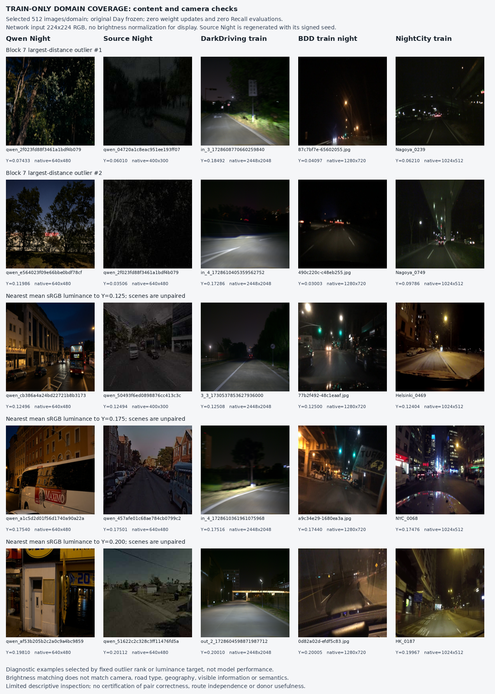

# P1：真实／合成训练夜景统计覆盖诊断

**当前判断：保留真实供体假说，但不据本轮结果启动 P2 训练。** DarkDriving 和 NightCity 在当前注入位置 block 7 的统计，大部分落在 Qwen＋Source 联合参考范围内，尚未显示强烈的新增覆盖证据。BDD 有较明显的范围外样本，但相机、道路内容和亮度差异仍足以混杂这一现象。干预在这 64 个接收样本上没有观察到极端通道增益；这既不能证明地点信息完好，也不能证明后续检索会提高。

原始结果：[report.json](report.json)；有限内容检查：[训练图像联系表](train_content_contact_sheet.png)。全部结论来自训练池，不含验证／测试供体、模型更新或 Recall 计算。

## 数据与计算边界

每个来源实际抽取 **512 张、512 个记录分组**，共 2,560 张训练输入。Qwen 和 Source 是完全相同的 512 个 GSV 样本／地点，Source 使用原训练流程的 epoch 0 增强与原始样本索引种子。其余来源与 GSV 不配对。DarkDriving 的分组表示精确内容连通分量，BDD／NightCity 的分组表示图像身份；这些数量都不能解释成已认证的独立路线数。

| 来源 | 合规训练池图像数 | 全部 512 张的平均 Y | Y<0.1 图像数 |
|---|---:|---:|---:|
| Qwen Night | 7,263 | 0.12485 | 98 |
| Source Night | 7,263 | 0.09483 | 307 |
| DarkDriving train Night | 9,520 | 0.19202 | 0 |
| BDD official train Night | 27,971 | 0.11539 | 239 |
| NightCity official train | 2,998 | 0.20313 | 17 |

Y 是缩放到 224×224 后、归一化前的平均 **sRGB 编码值加权亮度**，不是线性辐射亮度、曝光量或照明标签。表中数值覆盖所有已选 512 张；JSON 中 Qwen／Source 的覆盖分项及亮度分项仅针对下述 103 个校准地点，二者分母不同。

原始注册 Day DINOv2–SALAD 全部冻结、FP32 前向。在零起算 blocks 3、5、7 输出提取排除 CLS 的逐通道 μ、logσ。统计缓存绑定图像实际 SHA-256、训练清单／标签／审核文件、原始检查点、已加载模型状态、预处理、增强配置、前向代码和计算精度。运行前后模型状态 SHA-256 均为 `5e2d5c96d8873d27be163764bc13b9471b28aa912d08c3a1c170c96597fc1396`；optimizer updates=0，Recall evaluations=0。

本轮 Qwen 使用规范预处理后的原合成图，未叠加主训练中的 camera 增强；Source 使用既有 Source Night 构造。因此联合参考没有穷尽实际 camera-augmented Qwen 的训练支持范围，真实来源的范围外比例也不能直接称为“现有训练完全遗漏的比例”。需要继续该假说时，应先补充预先固定的相机增强参考测量。

## 覆盖结果：描述性范围包含率

Qwen＋Source 按共同地点整体划分：409 个拟合地点／818 行、103 个校准地点／206 行；同一地点的两种合成视图始终在同一侧。标准化和 PCA32 只拟合前者。每个样本到拟合参考的平均 5-NN 距离，以合成校准集的组加权经验 p95 为阈值。

下表为“不超过该阈值”的比例。Qwen／Source 各使用 103 个校准样本；三个真实来源各使用全部 512 个样本。

| 来源 | block 3 | block 5 | block 7 |
|---|---:|---:|---:|
| Qwen Night | 99.03% | 100.00% | 100.00% |
| Source Night | 91.26% | 90.29% | 90.29% |
| DarkDriving train Night | 81.64% | 96.29% | 94.92% |
| BDD train Night | 38.67% | 42.38% | 65.62% |
| NightCity train | 80.47% | 91.02% | 95.12% |

阈值依次为 21.8118、23.2783、22.8657，精确值见 JSON。不同层各自拟合坐标系，不能直接比较距离大小。PCA32 保留拟合参考加权方差的 **71.58%、55.89%、54.00%**；没有量化丢弃子空间的真实域偏移，因此范围内不等于完整特征空间已经覆盖。

**p95 阈值不是“95% 置信度”、风格概率、域分类准确率或因果证据。** 参考是 Qwen＋Source 的并集，不能把结果改称“Qwen 单独覆盖了真实域”。Qwen 比 Source 更靠近联合参考核心，也可能反映不同内容与增强分布的方差，不能据此选定更好的供体。

当前 block 7 上，DarkDriving 约 94.92%、NightCity 约 95.12% 的包含率接近经验参考标尺，支持“本指标下大部分并未明显超出联合合成参考范围”。它不证明二者没有可用信息；block 3 的差异也不能自动当成改变注入层的依据。BDD 的 65.62% 是值得继续检查的描述性差异。

在共同亮度分层 `[0.1,0.25)` 内，block 7 平均距离仍为 Qwen 16.856（n=91）、Source 20.183（n=47）、DarkDriving 18.851（n=497）、BDD 21.409（n=259）、NightCity 19.838（n=367）。在 `[0,0.1)` 内，BDD 为 23.473（n=239），Source 为 20.787（n=55），Qwen 为 17.197（n=12）。这说明均值亮度本身没有解释全部差异；样本量不平衡、场景／相机未匹配，也不能据此把余差归因为纯光照。

## 固定干预：报告实际强度，尚未强度匹配

五个供体库均为 512 个统计向量，使用完全相同的 64 张 Qwen 接收图、供体索引、Patch 掩码及 λ。`p=0.5, d=0.3, λ=0.2×(1−Beta(0.1,0.1))`，实际 **29／64 张启用**。同样的 λ 不等于同样的实际 ΔF；本轮没有根据指标反向调强度或裁剪 gain。

| 供体 | 全部64张 ΔF均值 | 启用29张 ΔF均值 | 启用 ΔF p95／最大 | 启用描述符余弦漂移均值 | 最大gain |
|---|---:|---:|---:|---:|---:|
| Qwen | 1.046% | 2.309% | 5.226%／5.723% | 0.000929 | 1.192 |
| Source | 1.292% | 2.850% | 6.209%／6.275% | 0.001230 | 1.183 |
| DarkDriving | 1.150% | 2.538% | 5.826%／5.958% | 0.001262 | 1.330 |
| BDD | 1.128% | 2.490% | 5.146%／5.333% | 0.001112 | 1.266 |
| NightCity | 1.095% | 2.416% | 5.808%／5.862% | 0.001468 | 1.185 |

ΔF 定义为每图 `RMS(实际Patch变化)/RMS(原Patch−该图通道均值)`；余弦漂移为 `1−cos(原Qwen描述符, 干预描述符)`。启用组也包括 Beta 分布产生的接近零 λ。gain 是启用图像通道的标准差混合比例，共 29×768 个观测，按接收地点分组；没有把通道数当成独立路线数。所有来源均未观察到 gain>2。

启用图上的 SALAD keep 分配平均绝对变化：Qwen 0.002642、Source 0.003230、DarkDriving 0.003142、BDD 0.002865、NightCity 0.003137；log-assignment 平均绝对变化分别为 0.04649、0.05593、0.05541、0.05162、0.05505。结构分配确实受到影响。未改动 CLS／未选 Patch，手动前后缀与原始 Day 推理精确一致。

这些观察只约束本轮有限输入的数值行为。未计算接收图与其清晰 Day 目标的对齐，也未证明地点证据得以保留。NightCity 的 ΔF均值小于 Source，但描述符漂移更大，进一步说明不能只匹配一个强度标量或把小漂移直接解释成有效正则。

## 训练图像的有限内容检查

联系表读取并重新核验所示图像的 SHA-256，仅使用已抽中的训练图像。前两行是每个来源 block 7 距离最大的两个样本；后三行分别选择最接近 Y=0.125、0.175、0.200 的图像，不重复训练或按模型好坏挑图。Source 图按缓存签名中的配置与种子再现；所有图展示实际 224×224 输入，没有提亮。亮度匹配行的场景彼此不配对。

本次对这 25 个面板的描述性检查可见：

- DarkDriving 的示例突出车灯照亮的近处路面、暗天空和绿化；最高距离示例之一还有明显运动模糊。同平均亮度的 Qwen／Source 示例往往包含建筑立面和停车街道，内容构成差异仍很大。
- BDD 的高距离示例是大片暗背景、稀疏灯点与低纹理道路。匹配亮度后仍有挡风玻璃／仪表台区域、反光和不同道路视角。所选 512 张的官方标签包含 132 张 highway、342 张 city street，另有 residential 等；天气包含 clear 402、rainy 46、snowy 53 等，不能把全部差异都称为夜间成像偏差。
- NightCity 的两张高距离示例包含高架道路结构；匹配亮度示例又包含雪地或密集城市招牌。这些内容与相机视野会影响 DINO 通道统计。相邻名称 `Nagoya_0749/0750` 也出现在高距离名单中，图像身份不同不能据此认证独立采集路线。
- Qwen 的两个高距离示例有较多树叶／植被；同一 `qwen_2f023fd88f3461a1bdf4b079` 也出现在 Source 高距离示例中。部分离群可能与内容组成有关。Source 的低照度和噪声处理能压暗现有图像，却不自动生成真实车灯、光源布局和车载视角。

这不是全量人工审核，不认证 DarkDriving 配对正确性、相机参数、路线独立性，也不把少量视觉观察外推到全部数据集。网络的统一方形缩放同样不能消除原始分辨率、视场和纵横比差异。

## 对后续工作的约束

1. 先完成既定 P0 多 seed A/B/C，独立评价真实配对监督；P1 的统计结果不能替代其检索证据。
2. DarkDriving／NightCity 暂无强 block 7 新增覆盖信号，不因此排除这些来源，但本轮不足以升级为真实供体训练或配对残差方法。
3. 若继续 H2，优先在训练池内检查 BDD 差异：固定道路／视场／天气分层，在相近亮度下比较内容组成与完整统计空间，并补充干预前后对清晰 Day 目标的对齐诊断。这里的分层和样本规模应先固定；不要从这些结果直接搜索 Recall 或挑注入层。
4. 只有可解释的剩余覆盖差异和地点信息保持证据同时成立，再冻结“无TFS／Qwen库／真实库”的 P2 对照，并匹配供体数、数据访问和实际 ΔF 分布。保留独立盲测，不使用测试夜图建立供体或调参。

本轮机器判据维持 `requires_content_review`，干预判据维持 `descriptive_only`。联系表完成了一个有限的内容检查环节，混杂尚未解除，不能将判据改为自动批准训练。
